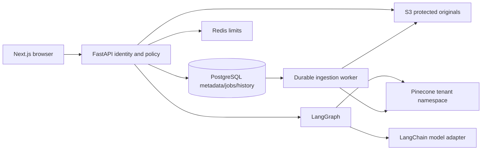

# Architecture and decisions

Modular monolith: FastAPI presentation → application services → domain policies/ports; SQLAlchemy, Pinecone, LangChain, S3 and queue adapters implement ports. Independently executable worker owns expensive parsing/embedding. Next.js consumes versioned HTTP and authenticated fetch SSE. PostgreSQL is authoritative; Redis is ephemeral. Default cloud target: ECS Fargate, not Kubernetes.

Bounded contexts: Identity/Tenancy, Knowledge/Ingestion, Retrieval, Conversations/Runs, Approvals/Tools, Quality/Operations. Domain policy does not import provider SDKs. Authenticated actor includes subject and tenant; membership checks are database decisions, not token-provided roles. Browser never gets database, vector or model secrets.

Development: explicit development bearer secret configured by operator, SQL-backed durable work queue, local disk storage and deterministic lexical/quote adapters. This permits genuine local upload/query/citation workflows without claiming semantic or generative quality. Production must reject development auth/providers and requires OIDC, PostgreSQL, Redis, S3 and Pinecone. SQS delivery is an optimization over a transactional job/outbox source, never the sole metadata record.

SQL rows carry tenant/workspace ownership; each API fetch uses scoped predicates. Pinecone namespaces are tenant IDs, metadata filters constrain KB/workspace. Matches are reauthorized against current document rows and chunk records, so deleted/outdated vectors cannot become evidence. Storage uses generated keys, never filenames supplied as paths.

Ingestion state: queued → processing (leased) → verifying → ready, or retry/failed. Immutable document generation and deterministic chunk IDs protect replay. Delete tombstones first; cleanup of originals/vectors can retry. Freshness requires actual query visibility of all expected IDs before ready. Workers must check generation and tombstone before publishing. Parsing has file/page/text/archive limits and production quarantine requires a scanner.

Graph: validate → retrieve → assess → answer OR abstain; privileged explicit action → approval interrupt → permission recheck → idempotent mutation → finish. No unconstrained agent loop. Persist checkpoints by tenant-scoped run ID. Only public stage summaries leave the graph. Use 30-second run timeout, bounded context and output, finite recursion limit. Agent text never chooses tenant or authorization.

Frontend: App Router, typed fetch contracts, TanStack Query for resource state, local streaming reducer and AbortController. Safe text/Markdown rendering; no raw HTML injection. API errors include safe message and request ID. POST fetch SSE carries authorization and emits stage, token, final, error. Disconnect cancels active generation; approval recovery uses a separate authorized resume route.

Cloud: public TLS ALB → private API tasks; private worker tasks → RDS/Redis/S3/SQS/provider egress. Separate task roles, Secrets Manager, encrypted buckets/databases, backup policy, CloudWatch/OTel. Staging deploy is not implied by Terraform existing. Production gate requires reviewed IAM, real identity, scanning, backups, load/evaluation evidence and budget.
