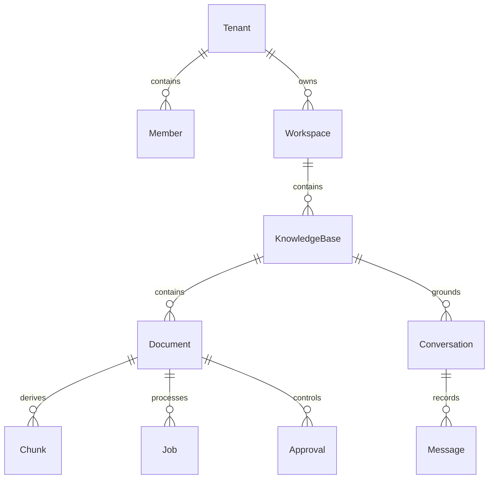

# Data model and consistency

PostgreSQL owns tenants, members, workspaces, workspace_access, knowledge_bases, documents, chunks, jobs, conversations, messages, approvals, feedback and events. LangGraph owns its checkpoint tables in the same database. See SQLAlchemy models and Alembic initial revision for executable schema.

Upload transaction creates document plus job after storing the source. Storage failure prevents SQL publication; SQL failure may leave an orphan object, requiring reconciliation before production. Deletion tombstones immediately, queues physical cleanup, and blocks source lookup/retrieval through SQL predicates. Already-streamed content cannot be recalled. Reprocess increments generation so old chunks are inaccessible immediately; jobs from older generations cannot publish ready status.

Approval decision is recorded before graph resume; side effect and completed receipt commit together under the approval row lock. Retry after a crash reuses the checkpoint and sees the receipt. The API rejects terminal approval replay. Queue retries are at-least-once; deterministic chunk IDs and generation checks make ingestion replay safe at the application layer. Old derived vectors can require cleanup after delete/upsert races; SQL prevents them from being returned as authorized evidence.

Current constraints: tenant scoping is application-enforced, not PostgreSQL RLS. Workspace/document policies are workspace-based, without per-document user lists. Initial migration contains frozen PostgreSQL DDL independent of later ORM changes. Full version-history retention and tenant purge are not implemented yet. Conversation deletion erases its messages, feedback and tenant/conversation-prefixed LangGraph checkpoints; active runs must finish or stop first.
